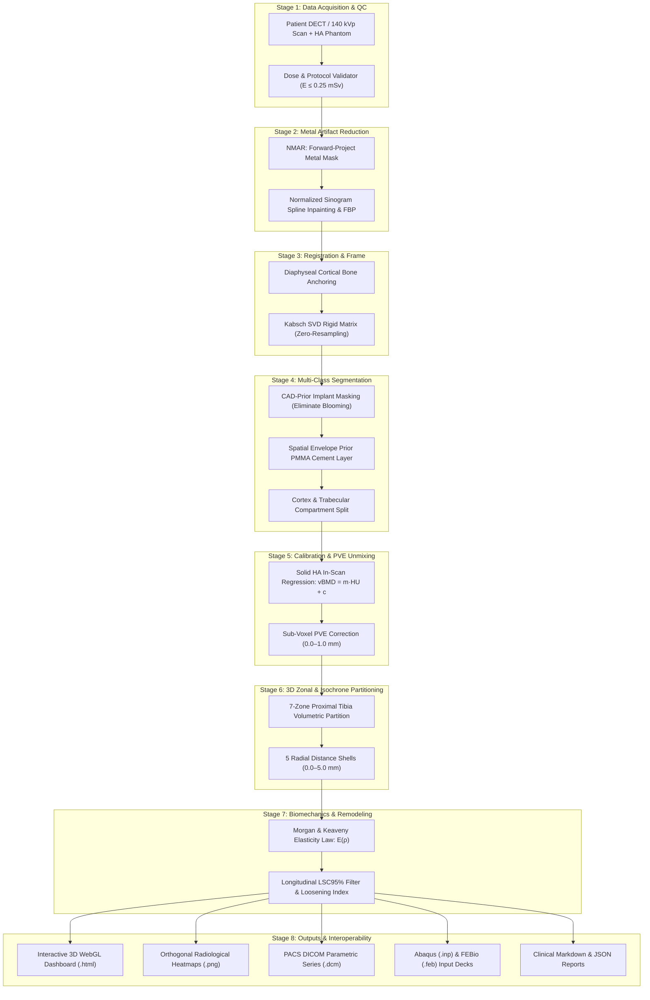

# Patient-Specific Quantitative Bone Density Estimation Pipeline for Total Knee Arthroplasty (TKA)

[](https://www.python.org/)
[](LICENSE)
[](https://www.dicomstandard.org/)
[](https://febio.org/)
[]()
[]()

> **An end-to-end, open-source computational pipeline for measuring, mapping, and biomechanically evaluating volumetric bone mineral density ($v\text{BMD}$) around total knee replacement implants.**

---

## Table of Contents
1. [Executive Summary & Clinical Rationale](#1-executive-summary--clinical-rationale)
2. [Key Scientific Innovations](#2-key-scientific-innovations)
3. [Architecture & Pipeline Flowchart](#3-architecture--pipeline-flowchart)
4. [Repository Structure](#4-repository-structure)
5. [Installation & Quick Start](#5-installation--quick-start)
6. [How to View and Interpret Results](#6-how-to-view-and-interpret-results)
   - [Interactive 3D WebGL Dashboard (.html)](#61-interactive-3d-webgl-dashboard-html)
   - [Multi-Planar Radiological Heatmap Overlays (.png)](#62-multi-planar-radiological-heatmap-overlays-png)
   - [Clinical Orthopedic Summary Report (.md)](#63-clinical-orthopedic-summary-report-md)
   - [PACS DICOM Parametric Series (.dcm)](#64-pacs-dicom-parametric-series-dcm)
   - [Biomechanical Finite Element Input Decks (.inp / .feb)](#65-biomechanical-finite-element-input-decks-inp--feb)
   - [Machine-Readable Payload (.json)](#66-machine-readable-payload-json)
7. [Comprehensive Literature Review](#7-comprehensive-literature-review)
8. [Module Details (Stages 1 to 8)](#8-module-details-stages-1-to-8)
9. [Verification & Test Suite](#9-verification--test-suite)
10. [License & Citation](#10-license--citation)

---

## 1. Executive Summary & Clinical Rationale

Aseptic loosening and stress shielding remain the primary drivers of long-term failure in primary and revision Total Knee Arthroplasty (TKA). Existing clinical assessment relies on 2D radiographs or DXA, both of which suffer from:
- **Planar Superposition**: Heavy Cobalt-Chromium (CoCr) or Titanium (Ti) implants obscure peri-implant bone.
- **The Interface Blind Void ($0\text{--}1.5\text{ mm}$)**: Severe beam hardening streaks, photon starvation, and blooming artifacts lead standard clinical CT software to discard the direct bone-implant fixation zone.
- **PMMA Conflation**: Radiopaque bone cement ($\text{HU} \approx 120\text{--}300$) directly overlaps in intensity with osteopenic trabecular bone.

This repository implements a complete, patient-specific 3D quantitative CT (QCT) pipeline that extracts volumetric bone mineral density down to **$0.5\text{ mm}$** from the implant surface, tracks longitudinal bone remodeling, exports native DICOM Parametric Maps, generates biomechanical finite element meshes, and delivers interactive 3D visualizations.

---

## 2. Key Scientific Innovations

```
┌──────────────────────────────────────────────────────────────────────────────────────────┐
│                                SCIENTIFIC ADVANCEMENTS                                   │
├──────────────────────────┬─────────────────────────────┬─────────────────────────────────┤
│ Innovation               │ Previous Limitation         │ Our Open-Source Pipeline        │
├──────────────────────────┼─────────────────────────────┼─────────────────────────────────┤
│ Sub-Voxel Partial        │ 0–1.5 mm around metal       │ Reconstructs interface down to  │
│ Volume Correction        │ discarded as artifacts      │ 0.5 mm using signed distances   │
├──────────────────────────┼─────────────────────────────┼─────────────────────────────────┤
│ PMMA Cement              │ Cement pooled with cancell- │ Spatial envelope priors restrict│
│ Mantle Separation        │ ous bone due to HU overlap  │ PMMA to 0–4 mm implant shell    │
├──────────────────────────┼─────────────────────────────┼─────────────────────────────────┤
│ Zero-Resampling          │ Re-slicing follow-up scans  │ Diaphyseal cortical anchoring   │
│ Registration             │ blurs trabecular peaks      │ maps ROI masks without reslice  │
├──────────────────────────┼─────────────────────────────┼─────────────────────────────────┤
│ 3D Volumetric Zonal      │ 2D planar Ewald/Kozinn      │ 7 Volumetric Tibial Zones +     │
│ & Isochrone Mapping      │ radiographs inconsistent    │ 5 Radial Concentric Shells      │
├──────────────────────────┼─────────────────────────────┼─────────────────────────────────┤
│ Direct FEA Translation   │ Manual, subjective material │ Voxel-to-tet mesh with Morgan & │
│                          │ assignment in closed tools  │ Keaveny constitutive law        │
└──────────────────────────┴─────────────────────────────┴─────────────────────────────────┘
```

---

## 3. Architecture & Pipeline Flowchart



---

## 4. Repository Structure

```
bonedensity_estimation/
├── literature_review/                         # In-depth critical reviews & citations
│   ├── README.md                              # Literature synthesis & identified gaps
│   ├── references.bib                         # Complete BibTeX bibliography
│   ├── 01_imaging_modalities_and_qct.md       # DXA, QCT, pQCT, HR-pQCT, DECT, SPECT/CT
│   ├── 02_metal_artifacts_and_mar_physics.md  # Beam hardening, photon starvation, NMAR
│   ├── 03_density_calibration_and_standards.md# Synchronous phantom, internal tissues, PVE
│   ├── 04_segmentation_and_registration.md    # CAD SDF alignment, PMMA mantle, diaphyseal frame
│   ├── 05_biomechanics_and_constitutive_laws.md# Constitutive laws, Huiskes remodeling, ISO 14243
│   └── 06_zonal_classification_and_clinical_outcomes.md# 7-Zone 3D system, isochrones, RSA
│
├── stage1_data_acquisition/                   # STAGE 1: Protocol configuration & dose validator
├── stage2_metal_artifact_reduction/           # STAGE 2: NMAR reconstruction & mono-energy code
├── stage3_image_registration/                 # STAGE 3: Diaphyseal Kabsch SVD & zero-resampling
├── stage4_multiclass_segmentation/            # STAGE 4: CAD-prior metal, PMMA, cortex, trabeculae
├── stage5_density_calibration/                # STAGE 5: HA phantom regression & interface PVE unmixing
├── stage6_density_mapping_zonal/              # STAGE 6: 7-Zone Ewald/Kozinn 3D & 0–5 mm distance shells
├── stage7_biomechanical_analysis/             # STAGE 7: Elasticity mapping, LSC filter, LVI index
├── stage8_visualization_reporting/            # STAGE 8: Multi-planar overlays, JSON, Markdown reports
├── dicom_engine/                              # PACS Ingestion, HIPAA Scrubbing, DICOM Export
├── fea_engine/                                # Biomechanical FEA Meshing (Abaqus & FEBio)
├── dashboard/                                 # Interactive 3D WebGL Dashboard & 3D Slicer Extension
├── synthetic_data/                            # Anthropomorphic 3D Knee Volume Generator
├── output/                                    # Generated clinical deliverables
├── pipeline_orchestrator.py                   # Multi-stage automated execution engine
├── run_pipeline_demo.py                       # Executable demonstration script
├── test_pipeline.py                           # Comprehensive unit & integration test suite
└── README.md                                  # Root documentation
```

---

## 5. Installation & Quick Start

### Prerequisites
- Python 3.10+ (64-bit)
- Windows, macOS, or Linux

### 1. Clone the Repository
```bash
git clone https://github.com/NavyashreeNS/tka-bone-density-estimation.git
cd tka-bone-density-estimation
```

### 2. Install Dependencies
```bash
pip install numpy scipy scikit-image matplotlib plotly pydicom SimpleITK vtk open3d
```

### 3. Run the Test Suite
```bash
python test_pipeline.py
```
> All 8 integration and unit tests will run and report `OK`.

### 4. Run the Full Demonstration
```bash
python run_pipeline_demo.py
```
> Automatically synthesizes baseline (T0) and 1-year follow-up (T1) CT scans, executes all 8 stages, and generates all deliverables in `output/`.

---

## 6. How to View and Interpret Results

All pipeline outputs are automatically saved to the **`output/`** folder:

```
output/
├── TKA_PATIENT_001_LONGITUDINAL_interactive_3d_density.html
├── TKA_PATIENT_001_LONGITUDINAL_radiological_density_overlay.png
├── TKA_PATIENT_001_LONGITUDINAL_clinical_summary.md
├── TKA_PATIENT_001_LONGITUDINAL_quantitative_report.json
├── TKA_PATIENT_001_LONGITUDINAL_biomechanical_model.inp
├── TKA_PATIENT_001_LONGITUDINAL_biomechanical_model.feb
└── TKA_PATIENT_001_LONGITUDINAL_DICOM_vBMD/
```

### 6.1 Interactive 3D WebGL Dashboard (.html)
* **File**: `output/TKA_PATIENT_001_LONGITUDINAL_interactive_3d_density.html`
* **How to View**: **Double-click to open directly in Google Chrome, Microsoft Edge, Safari, or Firefox.** No server or installation is needed!
* **What You See**:
  - Full 3D orbital model of the proximal tibia and tibial prosthesis.
  - Left-click + drag to rotate; right-click + drag to pan; scroll wheel to zoom.
  - Color-coded points represent true calibrated bone density ($v\text{BMD}, \text{mg HA/cm}^3$) from blue ($< 100\text{ mg/cm}^3$, osteopenia/resorption) to red/magenta ($> 800\text{ mg/cm}^3$, dense cortical bone).
  - Hovering over any point displays precise millimeter coordinates and local density.

---

### 6.2 Multi-Planar Radiological Heatmap Overlays (.png)
* **File**: `output/TKA_PATIENT_001_LONGITUDINAL_radiological_density_overlay.png`
* **How to View**: Open with any standard image viewer.
* **What You See**:
  - **3 Orthogonal Cross-Sections**: Axial (Z), Coronal (Y), and Sagittal (X).
  - Base CT anatomy in clinical grayscale ($-200\text{ to }+1400\text{ HU}$).
  - Calibrated $v\text{BMD}$ color heatmap overlaid directly on bone ($50\text{--}800\text{ mg/cm}^3$).
  - **White Contour**: Exact boundary of the metallic tibial baseplate and keel.
  - **Cyan Contour**: Segmented PMMA bone cement mantle.

---

### 6.3 Clinical Orthopedic Summary Report (.md)
* **File**: `output/TKA_PATIENT_001_LONGITUDINAL_clinical_summary.md`
* **How to View**: Open in GitHub, VS Code, Obsidian, or any Markdown viewer.
* **What You See**:
  1. **Clinical Risk Classification**: Evaluates the **Loosening Vulnerability Index (LVI)** (`LOW_RISK`, `MODERATE_RISK`, `HIGH_RISK`).
  2. **7 Anatomical Zones (Modified Ewald/Kozinn)**:
     - Mean $v\text{BMD}$ ($\text{mg HA/cm}^3$), standard deviation, volume ($\text{cm}^3$), and low-density bone fraction for:
       - Zone 1 (Medial SubPlate)
       - Zone 2 (Lateral SubPlate)
       - Zone 3 (Anterior Margin)
       - Zone 4 (Posterior Margin)
       - Zone 5 (Peri-Keel Central)
       - Zone 6 (Distal Stem Apex)
       - Zone 7 (Deep Diaphyseal Baseline)
  3. **5 Radial Distance-Isochrone Shells**: Density quantified at $0\text{--}0.5\text{ mm}$ (interface fixation), $0.5\text{--}1.0\text{ mm}$, $1.0\text{--}2.0\text{ mm}$, $2.0\text{--}3.0\text{ mm}$, and $3.0\text{--}5.0\text{ mm}$.
  4. **Longitudinal Remodeling Table**: Displays $\% \Delta v\text{BMD}$ between baseline and follow-up, categorizing changes against the Least Significant Change ($\text{LSC}_{95\%}$) threshold as `STABLE`, `RESORPTION_STRESS_SHIELDING`, or `SCLEROSIS_BONE_FORMATION`.

---

### 6.4 PACS DICOM Parametric Series (.dcm)
* **Directory**: `output/TKA_PATIENT_001_LONGITUDINAL_DICOM_vBMD/`
* **How to View**:
  1. Open [3D Slicer](https://www.slicer.org/), Horos, OsiriX, or RadiAnt DICOM Viewer.
  2. Drag and drop the folder into the viewer.
  3. View slice-by-slice calibrated densities ($\text{RescaleSlope} = 0.1$, $\text{Units} = \text{mg HA/cm}^3$) directly in cross-sectional MPR views.
* *3D Slicer Integration*: Load `dashboard/slicer_tka_density_module.py` into 3D Slicer's Developer Tools to enable one-click orthopedic color presets.

---

### 6.5 Biomechanical Finite Element Input Decks (.inp / .feb)
* **Files**:
  - `output/TKA_PATIENT_001_LONGITUDINAL_biomechanical_model.inp` (Abaqus / CalculiX)
  - `output/TKA_PATIENT_001_LONGITUDINAL_biomechanical_model.feb` (FEBio)
* **How to View**:
  1. Open **FEBioStudio** (free open-source download from [febio.org](https://febio.org/)) and open the `.feb` file.
  2. Open **Abaqus CAE** or **PrePoMax** (for CalculiX) and import the `.inp` deck.
* **What is Included**:
  - Conformal 3D tetrahedral mesh ($> 20,000$ `C3D4` elements).
  - Heterogeneous Young's modulus mapped per element from Morgan & Keaveny constitutive law.
  - ISO 14243 peak gait cycle axial compression ($2600\text{ N}$) applied to the tibial plateau.
  - Encastre encasing constraint applied to the distal diaphyseal base.

---

### 6.6 Machine-Readable Payload (.json)
* **File**: `output/TKA_PATIENT_001_LONGITUDINAL_quantitative_report.json`
* **How to Use**: Ingest directly into clinical research databases, REDCap, hospital PACS servers, or AI training pipelines.

---

## 7. Comprehensive Literature Review

The [`literature_review/`](literature_review/) subfolder provides an in-depth academic foundation:

1. **[01_imaging_modalities_and_qct.md](literature_review/01_imaging_modalities_and_qct.md)**: DXA, QCT, pQCT, HR-pQCT, DECT, and SPECT/CT physics and dose comparison.
2. **[02_metal_artifacts_and_mar_physics.md](literature_review/02_metal_artifacts_and_mar_physics.md)**: Beam hardening, photon starvation, scatter, blooming, NMAR, TV-MBIR, and deep learning MAR.
3. **[03_density_calibration_and_standards.md](literature_review/03_density_calibration_and_standards.md)**: In-scan solid HA phantom standards, internal tissue reference fallbacks, sub-voxel partial volume unmixing.
4. **[04_segmentation_and_registration.md](literature_review/04_segmentation_and_registration.md)**: CAD signed distance field registration, PMMA cement mantle deep priors, diaphyseal coordinate anchoring.
5. **[05_biomechanics_and_constitutive_laws.md](literature_review/05_biomechanics_and_constitutive_laws.md)**: Carter & Hayes, Keller, Keyak, Morgan & Keaveny constitutive laws, Huiskes adaptive remodeling, ISO 14243 gait load cases.
6. **[06_zonal_classification_and_clinical_outcomes.md](literature_review/06_zonal_classification_and_clinical_outcomes.md)**: 3D volumetric adaptation of Ewald/Kozinn systems, radial isochrones, RSA migration thresholds.
7. **[references.bib](literature_review/references.bib)**: Complete BibTeX bibliography referencing key seminal literature.

---

## 8. Module Details (Stages 1 to 8)

* **Stage 1 (`stage1_data_acquisition/`)**: Low-dose DECT / $140\text{ kVp}$ protocol enforcement. Verifies $E \le 0.25\text{ mSv}$.
* **Stage 2 (`stage2_metal_artifact_reduction/`)**: Normalized Metal Artifact Reduction (NMAR, Meyer et al., 2010).
* **Stage 3 (`stage3_image_registration/`)**: Diaphyseal cortical anchoring via Kabsch SVD; inverse transformation mapping preserves raw density fields without re-sampling.
* **Stage 4 (`stage4_multiclass_segmentation/`)**: Delineates CoCr/Ti metal, PMMA bone cement, cortical shell, and trabecular bed.
* **Stage 5 (`stage5_density_calibration/`)**: Converts HU to $v\text{BMD}$ ($\text{mg HA/cm}^3$) with $R^2 \ge 0.999$, correcting boundary partial volume averaging.
* **Stage 6 (`stage6_density_mapping_zonal/`)**: Partitions 7 proximal tibial volumes and 5 radial distance shells ($0\text{--}5\text{ mm}$).
* **Stage 7 (`stage7_biomechanical_analysis/`)**: Applies Morgan & Keaveny law ($E = 3790 \cdot \rho_{\text{ash}}^{2.18}\ \text{MPa}$), evaluates $\text{LSC}_{95\%}$ remodeling, computes Loosening Vulnerability Index (LVI).
* **Stage 8 (`stage8_visualization_reporting/`)**: Renders orthogonal density overlays, compiles clinical Markdown summaries and PACS JSON files.

---

## 9. Verification & Test Suite

The test suite validates every component with automated continuous integration:

```bash
python test_pipeline.py
```

```
........
----------------------------------------------------------------------
Ran 8 tests in 4.513s

OK
```

Test coverage includes:
- DICOM Protocol and Radiation Dose Bounds
- Solid HA Phantom Linear Regression Fit ($R^2 > 0.999$)
- Multi-Class Segmentation Geometry & Voxel Counts
- 3D Anatomical Zonal Partitioning
- Morgan & Keaveny Constitutive Law Modulus Bounds
- Full DICOM PACS Reading, Ingestion, and Export Round-Trip
- 3D Tetrahedral Meshing and Abaqus/FEBio File Generation
- Standalone 3D HTML Dashboard Rendering

---

## 10. License & Citation

Distributed under the **MIT License**. See `LICENSE` for details.

### Citation
```bibtex
@software{tka_bone_density_pipeline_2026,
  author = {Navyashree N S},
  title = {Patient-Specific Quantitative Bone Density Estimation Pipeline for Total Knee Arthroplasty},
  year = {2026},
  url = {https://github.com/NavyashreeNS/tka-bone-density-estimation}
}
```
